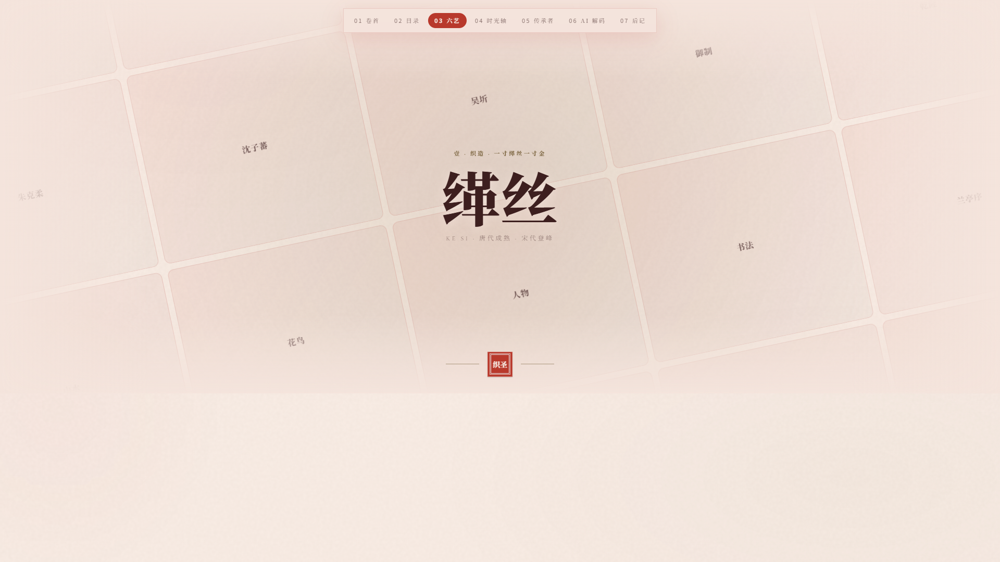
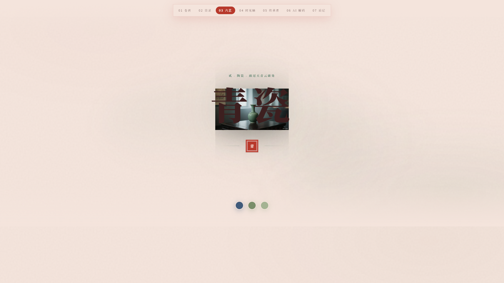
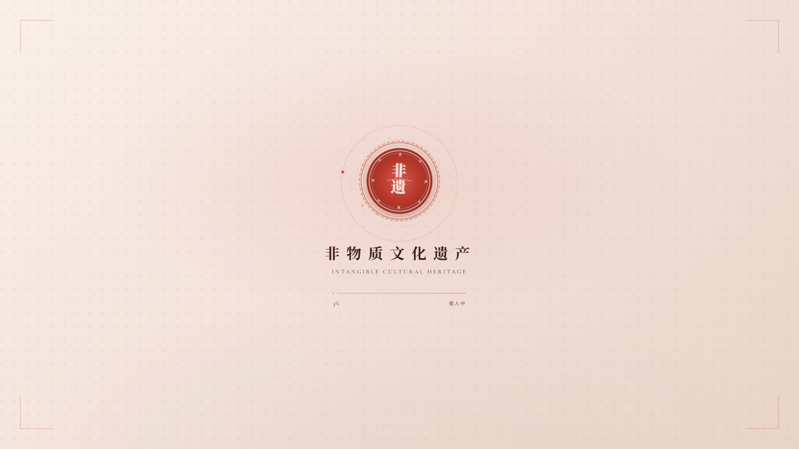
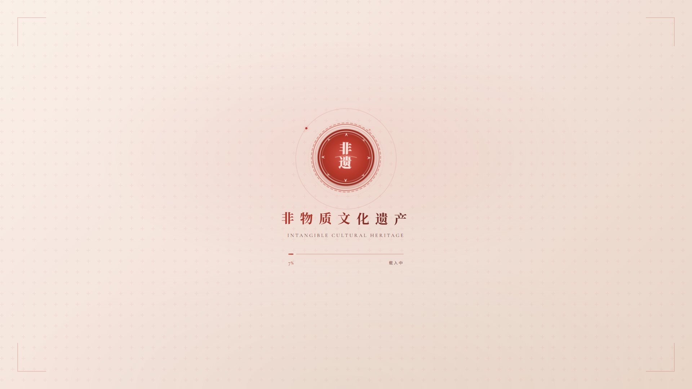
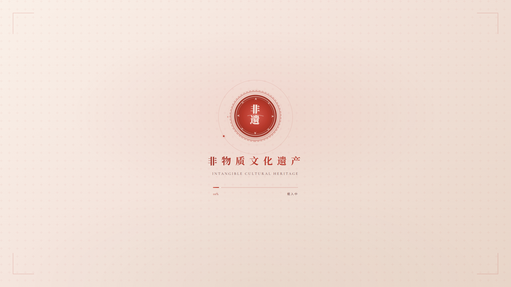
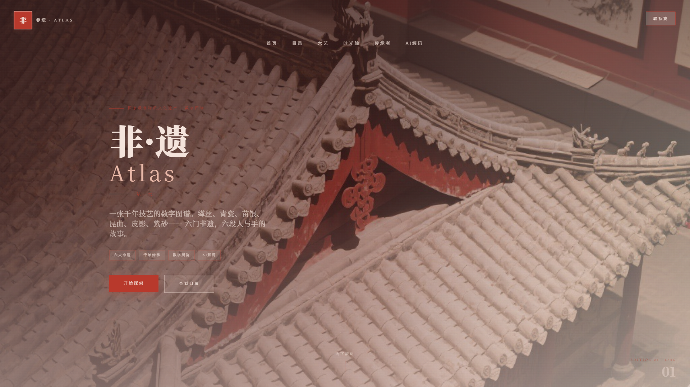

【标签】生活娱乐
【标题】【生活娱乐赛道】非遗图鉴 — 用交互设计让传统文化「活」起来

---

### 先和大家打个招呼吧 👋

**你是谁**：
> 一名对传统文化和设计都很感兴趣的学生，想用自己的方式让更多同龄人看到非遗之美。

**你是怎么用 TRAE 把 Demo 做出来的**：
> 最初的想法很简单——想做一个有温度的非遗展示网站，但一个人从零开始做 React 项目，光是动画效果就让我头疼。抱着试试看的心态，我把想法一句句讲给 TRAE 听：
> 
> - "给光标加个皮影小人的轨迹效果" — 它真的做出来了，还帮我用 AI 生成了真实的皮影图片
> - "六个非遗页面，每个都要有不一样的动态顶部效果" — 从缂丝的织纹矩阵、青瓷的水墨晕染，到皮影的幕布光影、紫砂的陶土浮雕，每一页都是独一无二的
> - "帮我部署到 Netlify 上" — 从 Git 初始化到配置代理再到部署上线，全程手把手指导
> 
> 最让我惊喜的是 GridMotion 组件——原本以为要花好几天调的网格动效，TRAE 不仅写出来了，还完美适配了非遗的朱红色主题。那种"原来这么简单"的感觉，真的太爽了！

---

### 1. Demo 简介

**是什么**：
> 一个沉浸式非遗文化数字出版物网站，以「非遗六艺」（缂丝、青瓷、苗银、昆曲、皮影、紫砂）为核心，通过丰富的交互动效和视觉设计，让用户在浏览中感受传统文化之美。

**面向谁**：
> - 对传统文化感兴趣的年轻人
> - 非遗文化爱好者和研究者
> - 希望了解中国传统技艺的普通用户

**主要功能**：

**① 六艺详情页 — 每页独特动态视觉**
> 缂丝、青瓷、苗银、昆曲、皮影、紫砂，六大非遗门类，每页都有专属的顶部动效和布局设计：
> - 缂丝：织纹矩阵网格运动效果
> - 青瓷：水墨晕染+瓷瓶悬浮旋转
> - 苗银：银饰纹样流动+金属光泽
> - 昆曲：水袖飘动+脸谱剪影
> - 皮影：幕布光影+皮影剪影游动
> - 紫砂：陶土浮雕+壶型阵列

**【截图】缂丝页面 — GridMotion 织纹矩阵效果：**
> 

**【截图】青瓷页面 — 水墨晕染+瓷瓶悬浮：**
> 

**【截图】皮影页面 — 幕布光影效果：**
> 

**【截图】紫砂页面 — 陶土浮雕+壶型阵列：**
> 

**【截图】苗银页面 — 银饰纹样流动：**
> 

**【截图】昆曲页面 — 水袖飘动+脸谱剪影：**
> 

**② 皮影光标轨迹 — 非遗元素触手可及**
> 鼠标移动时，可爱的皮影小人会跟随光标留下流动轨迹，让非遗元素不再是隔着玻璃的展品，而是真正"碰得到"的互动体验。

**③ 3D 交互卡片 — 图文结合的沉浸阅读**
> 悬停揭示卡、翻转卡、视差卡多种交互形式，图片和文字巧妙结合，鼠标悬停时文字缓缓浮现，既增加了阅读的趣味性，又让页面不会因为文字太多而显得拥挤。

**④ AI 解读模块 — 智能讲解非遗技艺**
> 点击非遗项目的 AI 解读按钮，即可查看 AI 对该技艺的深度分析和趣味解读。

**⑤ 时间轴与传承人 — 读懂非遗的来龙去脉**
> 纵向时间轴清晰展示每项非遗的发展脉络，传承人卡片介绍匠人的故事，让用户不仅看到技艺，更看到背后的人。

---

### 2. Demo 创作思路

**灵感来源**：
> 逛博物馆时发现，非遗展区总是最安静的角落——精美的展品隔着玻璃，文字说明冷冰冰的，年轻人拍张照就走了。我在想：能不能用互联网的方式，让这些老手艺「活」过来？不是教科书式的介绍，而是能摸、能玩、能沉浸的体验。

**想解决的问题**：
> 1. **展示形式单一**：传统非遗介绍多是文字+图片，缺乏互动性，难以吸引年轻群体
> 2. **视觉表达陈旧**：很多非遗网站设计保守，没有体现非遗本身的美学价值
> 3. **距离感太强**：用户只是「看客」，没有参与感，看完就忘

**为什么做这个方向**：
> 选择「数字出版物」形态，是因为它介于「纯展示网站」和「游戏化应用」之间——既有出版物的深度内容，又有网页的交互灵活性。
> 
> 选六个非遗项目也是有意为之：织造、陶瓷、金属、戏曲、偶戏、器物，涵盖了不同门类，能展示中国非遗的多样性。每一页用完全不同的视觉语言，也是想告诉大家：非遗不是「老古董」的代名词，它可以很潮、很美、很有设计感。
> 
> 朱红、米色、墨黑的传统配色，配上现代的动效设计，希望能在「传统」和「现代」之间找到一个舒服的平衡点。

---

### 3. Demo 体验地址

**🔗 在线体验链接**：https://bejewelled-narwhal-30a354.netlify.app

> 💡 推荐使用电脑端浏览，移动鼠标体验皮影光标轨迹效果～

**📦 GitHub 仓库**：https://github.com/chinazhoujf/Intangible-Cultural-Heritage

---

### 4. TRAE 实践过程

**完整开发流程**：

| 阶段 | 内容 | TRAE 协助方式 |
|------|------|--------------|
| 项目初始化 | Vite + React + TypeScript 项目搭建，Tailwind CSS 配置 | 一键生成项目结构和配置文件 |
| 页面架构设计 | 首页布局、六艺详情页结构、路由设计 | 根据需求设计组件化架构，生成页面骨架 |
| 核心交互组件 | GridMotion、HoverRevealCard、FlipCard、ParallaxCard、TextCursor | 从零编写自定义组件，适配非遗主题色 |
| 六页定制效果 | 缂丝/青瓷/苗银/昆曲/皮影/紫砂各页面独特视觉效果 | 每页单独设计动效方案，反复调整细节 |
| 内容填充 | 非遗数据、匠人故事、时间轴等内容整理 | 协助生成结构化数据，优化文案表达 |
| 部署上线 | Git 仓库初始化、GitHub 推送、Netlify 部署 | 全程指导，解决网络代理等各种问题 |

**关键开发步骤截图**：

**【截图 1】项目首页 — 非遗图鉴封面与目录：**
> 

**【截图 2】缂丝详情页 — GridMotion 织纹矩阵动效：**
> 

**【截图 3】青瓷详情页 — 水墨晕染+瓷瓶悬浮旋转：**
> 

**【截图 4】皮影详情页 — 幕布光影+皮影剪影游动：**
> 

**【截图 5】紫砂详情页 — 陶土浮雕+壶型阵列环绕：**
> 

> 💡 以上截图均取自实际运行的 Demo，截图文件保存在 `screenshots/` 目录中，发帖时请手动上传图片。

**关键任务对话 Session ID**：

> Session ID 是 TRAE 每段对话任务的唯一标识，用来证明作品确实由 TRAE 开发完成。以下是本项目开发过程中的关键会话：

1. **Session ID: `6a32b1deac114ccf3d51d50d`**（核心开发会话）
   - 内容：六艺详情页定制效果开发、GridMotion 网格动效组件、TextCursor 皮影光标效果、3D 交互组件实现、Netlify 部署上线
   - 时间：2026-07-05 ~ 2026-07-14

2. **Session ID: `6a3a94893abe809b941d0f42`**（中期开发会话）
   - 内容：页面架构设计、非遗数据结构化、AI 文生图素材生成、交互动效调优
   - 时间：2026-06-23

3. **Session ID: `6a53515eee25c3baa4f9cef6`**（部署上线会话）
   - 内容：Git 仓库初始化、GitHub 代码推送、Netlify 部署配置与上线、代理网络问题解决
   - 时间：2026-07-12

> 💡 **怎么找 Session ID？**
> 打开 TRAE 中对应的对话，点击对话窗口左上角的 TRAE 头像，顶部提示 "Copy Success" 即复制成功。

---

### 5. 对应的报名审核通过的帖子链接

> （请在此处粘贴报名审核通过的帖子链接）

---

### 🌟 经验总结 & 踩坑复盘

**学到的东西**：
> 1. **组件化思维很重要** — 把重复的交互（如翻转卡、悬停揭示）抽成组件，后面改起来特别方便
> 2. **动效要服务于内容** — 不是越炫越好，缂丝用织纹矩阵、青瓷用水墨晕染，动效和主题契合才高级
> 3. **AI 图片是神器** — 非遗相关的高质量图片很难找，用 TRAE 的文生图 API 直接生成，风格统一又贴合主题

**踩过的坑**：
> 1. 鼠标光标效果一开始监听容器的 mousemove，结果因为 `pointer-events: none` 完全没反应，改成监听 `document` 就好了
> 2. Netlify 部署 SPA 应用一定要配置路由重定向，不然刷新页面就 404
> 3. Git 推送 GitHub 遇到网络问题，配置了代理端口 7897 才解决
